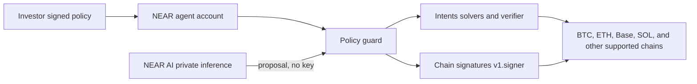

# Hackathon spec: NEAR portfolio agent

Tobé Madu. 12 Nov 2026.

Hackathon development closes 14 Nov 2026, 23:59 UTC. Judging runs 16 to 18 Nov 2026, per [nearhackathon.com](https://nearhackathon.com/). This repository is the written spec and investment case. It contains no agent implementation.

The investment write-up is [INVESTMENT_CASE.md](INVESTMENT_CASE.md). The judge's script is [DEMO.md](DEMO.md).

## How to read labels

- **Fact.** Documented or otherwise public as of this writing. Sources are at the end.
- **Inference.** A conclusion from those facts. It can be wrong.
- **Proposal.** Not live. Requires a change this hackathon does not ship.
- **Estimate.** A number with a method, or the author's round number. Not a quote from a protocol at a timestamp unless a source is named.
- **Assumption.** A parameter this spec picks so the build can be tested. The author did not set that number.
- **Author's argument.** A comparison the author wants in the case. It is not a survey.

## Assumptions used below

1. Drift is the absolute gap between current weight and target weight, in percentage points. A rebalance is allowed when any sleeve is 5 points or more away from target. This is the spec's reading of the author's "rebalance at 5% drift."
2. On the $500,000 illustration, the daily trade cap is $10,000, which is 2% of that NAV. The author required a max trade size per day and did not set the dollar amount.
3. The agent skips a trade smaller than $100. Assumption, so dust does not loop.
4. When several trades qualify, the most overweight sleeve funds the most underweight sleeve. Size is the minimum of the overweight gap, the underweight gap, and the remaining daily cap.
5. ORE in this book means the Solana mining token, held as an SPL token on the account's Solana derivation path.
6. Revenue-to-cap figures are the author's approximations as of 12 Nov 2026, using last-30-day DefiLlama revenue annualized (multiplied by 12) divided by market cap. This repo does not re-pull DefiLlama.
7. The author's weights sum to 99%. Demo math parks the residual 1% in stablecoins. The author's stated stablecoin weight remains 3%.
8. Live hackathon transactions are testnet, or a mainnet amount inside a separate tiny cap. The $500,000 book is a fixture.

## Problem

Running the book the author considers worth holding is a sequence of actions: buy, rebalance when weights move, stake, lock, vote, and notice unlocks. Each action is small. Together they are a job. The author, with more than ten years in crypto, will not do that job by hand. The book that requires less clicking is the book that stays in force. The strategy loses to the workload.

The failure mode is specific. Targets exist in the investor's head. Six months later the weights are somewhere else, rewards are unclaimed or unstaked, and a lock vote was missed. Nothing in that outcome required a new opinion. It required attendance.

## User

**Primary user.** An experienced crypto investor who already has a book in mind and does not want an operating role. They can read a policy, sign it, and review a log once a quarter. The author is this user.

**Secondary user.** A retail holder who wants the same shape at a smaller size: targets, a band, a hard cap. Retail is not the hackathon user. A retail product has a higher bar on defaults, custody, and regulation, because that user will not audit a policy file. The same guardrails are the product later. The MVP does not onboard retail.

## Solution

The investor signs a policy a few times a year. A NEAR agent account acts only inside that policy until the investor changes it or hits the kill switch. Doing nothing at the quarterly review leaves the same policy in force.

The agent's jobs on the full book:

1. Initial buys through NEAR Intents, into the agent's own derived addresses.
2. Rebalance when drift hits the band, in clips no larger than the daily cap.
3. Stake every asset on the staking allowlist. Nothing off the list is staked.
4. Weekly veAERO vote, only under a vote rule that is already in the signed policy.
5. Reminders for governance votes and for unlock dates. A reminder is not a vote.
6. A quarterly report. The report asks for a signature only when a rule should change.

The line the author uses: only judgment is required from the investor, not action. The judgment is the policy. The action is the fill, the stake, and the reminder.

## Guardrails

The policy is a JSON document. The investor signs the SHA-256 of its canonical form (UTF-8, object keys sorted, no insignificant whitespace). The guard contract stores the hash. The agent cannot replace it.

The investor's full-access key can update the policy, add an address, and flip the kill switch. The agent's key is a NEAR function-call access key. It may call the guard. It cannot transfer NEAR, add keys, or deploy code.

| Rule | Concrete setting |
| --- | --- |
| Allowed assets | The sleeves in the book below. Anything else is refused. |
| Targets | Weights in that book. |
| Drift band | 5 percentage points, absolute. Trigger at greater than or equal to 5. |
| Max trade per day | $10,000 on the illustrative NAV. Assumption. See above. |
| Venues | NEAR Intents only, until the investor adds another. |
| Solvers | Logged on every fill. An empty allowlist accepts the solver Intents returns. A non-empty list is enforced. The agent cannot require solvers to stake NEAR. That is the proposal, and it is a protocol rule. |
| Staking allowlist | Named instrument and program address, per asset below. |
| Lockup limits | veAERO only, and only the AERO sleeve. No longer lock and no larger sleeve without a new signature. |
| Spend cap | The daily trade cap, plus a per-transaction cap equal to it. |
| Withdrawals | No transfer to a new address unless that address is already in the signed policy. The list starts empty. |
| Program deposits | Allowed only for program addresses written in the staking allowlist. Those are not "new withdrawal addresses." They are named venues. |
| Intents settlement | Allowed only to the agent's own derived addresses for the chains in the policy. |
| Quarterly review | Report of positions, drift, actions, fees, stake results, and the policy hash. Signature only for a rule change. |
| Action log | Append-only: time, policy hash, proposal, decision, venue, asset, amount, destination, result. |
| Kill switch | Investor pauses the guard. The agent key cannot unpause. Open positions stay where they are. No new intent and no new signature request. |

A trade can be inside the policy and still be a poor trade. The guard checks permission. It does not check whether the investor will like the price later. Quote limits belong in the policy if the investor wants them (for example, a maximum spread against a reference). The MVP can ship without a price limit and must say so in the log.

Private inference, when used, proposes an action. It does not hold a key and it does not authorize a transaction. NEAR AI Cloud's docs describe TEE isolation and attestation. Attestation is evidence about the runtime. It is not evidence that the portfolio math is right. If the hackathon build skips live inference, the proposal is a deterministic function of the policy and the balances, and the log says `source: deterministic`.

## Illustrative book

**Illustration, not advice.** Reference NAV $500,000. Dollar columns use that NAV and the author's weights. They are not a quote.

Revenue notes are the author's approximations as of 12 Nov 2026, method above. A high revenue-to-cap ratio can mean a small cap, a broad revenue definition, or both. It is not a yield.

The author's weights sum to 99%. The residual $5,000 (1%) is parked in stablecoins for rows that need to add up. Author stablecoin target stays 3% ($15,000). Demo cash is then $20,000. That park is a documentation choice.

| Asset | Weight | Dollars | What it is in this book | Execution |
| --- | --- | --- | --- | --- |
| BTC | 53% | 265,000 | Hard money. Native BTC. Not staked. | Chain-signature hold. Own derivation path. |
| HYPE | 10% | 50,000 | Author approx. $826M annualized revenue on a $17B cap, about 4.9%. Author says the revenue is mostly buybacks. Stake about 2% to 2.5%. | Intents to buy. Stake if the stake program is on the allowlist. |
| ZEC | 5% | 25,000 | Private money, in the author's words. | Open. NEAR lists Zcash for chain signatures. Shielded ZEC is the private form, and a shielded spend is not the same as the documented signature. See risks. |
| XMR | 4% | 20,000 | Private money. | Manual sleeve. The agent must not move it. See risks. |
| ETH | 4% | 20,000 | Staked as stETH. Author stake rate about 3%. | Intents or chain signature. Stake only into the allowlisted stETH path. |
| SOL | 4% | 20,000 | Staked via JitoSOL. Author stake rate about 7%. | Chain signature on Solana. Liquid stake only at the allowlisted program. |
| SKY | 4% | 20,000 | Author approx. 12% revenue/cap, plus staking rewards. The 12% is not the staking rate. | Intents to buy. Stake only if the instrument is named. |
| AERO | 3% | 15,000 | Author approx. 62% revenue/cap. Author's plan: lock as veAERO and vote weekly, which is how Aerodrome directs fees and emissions to lockers. The 62% is not a lock APR. | Chain signature on Base. Lock is capped to this sleeve. |
| AAVE | 3% | 15,000 | Author approx. 3.6% revenue/cap. Safety-module stake. Slashable in a shortfall. | Stake only with `slashable: true` stored in the policy the investor signed. |
| JUP | 2% | 10,000 | Author approx. 7% revenue/cap. Author says buybacks, and a separate stake for governance with quarterly rewards that vary. No stake APR is stated. | Intents to buy. Stake only on the allowlist. No auto-vote. |
| LTC | 1% | 5,000 | Mined money. | Chain signature, own derivation path, because of the Bitcoin-like replay warning. |
| ORE | 1% | 5,000 | Mined money. Assumption: the Solana token. | SPL balance on the Solana path. Not staked in this policy. |
| KMNO | 1% | 5,000 | Author approx. 3.9% revenue/cap. | Hold. No stake until a policy names one. |
| RAY | 1% | 5,000 | Author approx. 6% revenue/cap. Author says buybacks. | Hold. Buybacks are not a staking APR. |
| Stablecoins | 3% | 15,000 | Dry powder. | The agent's own stable balance. |
| Residual | 1% | 5,000 | Unallocated weight, parked in stables for the sum. | Same sleeve as stables in the demo fixture. |

**Excluded, by the author's screen.** Tokens whose revenue, in the author's view, comes from users who mostly lose, or from a toll on those users. Named examples: SOL-ecosystem extraction tokens such as PUMP, and TRX. Memes are out. Tokens without demonstrated revenue are out. This is a selection rule, not a finding of fraud.

**Estimate (author), staking only.** About 1.5% to 2% of NAV per year of extra return from staking, locks, and governance rewards across the whole book. On $500,000, about $7,500 to $10,000 a year, before price moves, fees, and slashing.

Named rates only, using the 2.25% midpoint of the author's HYPE stake range:

- HYPE: 10% times 2.25% = 0.225 percentage points of NAV
- ETH as stETH: 4% times 3% = 0.120
- SOL as JitoSOL: 4% times 7% = 0.280
- Sum: about 0.63 percentage points, about $3,100 a year on $500,000

The gap between about 0.6% and the author's 1.5% to 2% is yield the author did not quantify, on SKY, veAERO, the AAVE safety module, JUP, and any later stake on KMNO or RAY. Those rates are left blank on purpose. Revenue-to-cap ratios are not added to this estimate. AAVE can be slashed, so the safety-module term can be negative.

## Architecture

Read the diagram from the investor's policy, through the NEAR agent account, to Intents and chain signatures, then to the target chains.

The guard is the part that can say no. The model, if it is in the loop, emits a proposal struct: asset in, asset out, amount, venue, destination. The guard checks the struct against the stored policy hash and the balances it was given. Then it either submits an intent or requests a signature from `v1.signer`. The destination on a signature request has to match an allowlisted program or the agent's own derived address.

Balance inputs are a risk. A wrong balance creates a false drift. The MVP may use a fixture file. The log field `balances_source` is `fixture` or `chain`, with the chain named. A fixture run is a valid demo. It is not a claim about live holdings.

## MVP

Realistic scope for a build that has to be submitted by 14 Nov 2026, 23:59 UTC. About two days from the date of this spec. One path, on a three-asset test policy, plus the refusals.

In the MVP:

1. Policy file for the test book in [DEMO.md](DEMO.md), signature check, and stored hash.
2. Drift calculation from a fixture, with the rule and the $10,000 cap.
3. One rebalance through NEAR Intents: a quote and a settlement on testnet, or a recorded quote plus one small fill if the builder has funds. The log shows the solver id and the amount.
4. One stake of one asset. Preferred: a Solana devnet transaction signed via chain signatures for the SOL sleeve. If a JitoSOL deposit does not exist on devnet, sign a native stake instruction on devnet for a tiny amount and log `instrument: native-stake-devnet`. The illustrative instrument remains JitoSOL.
5. One reminder row for the weekly veAERO vote or the quarterly review. No vote is cast.
6. Action log, kill switch, and a rejected withdrawal to a new address with no signature request.

Out of the MVP:

- Buying or rebalancing the full illustrative book.
- Moving XMR, or spending shielded ZEC.
- Casting a veAERO vote or any governance vote.
- A production custody review.
- The solver-stake and holder-fee change.

Suggested tracks, if the builder submits: 02 Investment Thesis, for this case; 01 Unstoppable DeFi, for the Intents rebalance; 06 AI Security and Defense, for the policy guard, the function-call key, and the kill switch. One project, multiple tracks, which the hackathon form allows. Track 02 asks for evidence someone can re-run. These revenue ratios are author-supplied. A live DefiLlama pull is a stretch goal, not a claim that this repo refreshed them.

Submission facts from the hackathon site: a public repository, a public X post that says the work was built at NEAR HACKATHON, tags `@NEARProtocol` and `#NEARHackathon`, and includes a demo video or screenshots, then the form with a NEAR account, the repo URL, and the post URL. This spec does not file that form.

## Stretch

- Live balances for BTC, ETH, and SOL, with `balances_source: chain`.
- The full target list as policy data, still refusing XMR movement.
- stETH, JitoSOL on mainnet inside a tiny cap, and an AAVE safety-module deposit flagged slashable.
- A veAERO lock of a test amount and one vote under a signed pool rule.
- Quarterly report generated from the log.
- Attestation id from NEAR AI Cloud stored on the proposal.
- A small script that re-pulls DefiLlama revenue and market cap and writes the ratios next to the author's figures, with the pull timestamp.

## Success metrics

Pass or fail, on the demo fixtures.

| Check | Pass |
| --- | --- |
| Policy hash | Recomputed SHA-256 matches the hash the investor signed and the hash the guard stores. |
| Fixture rebalance | Exactly one intent. Amount equals the minimum of the gap and the $10,000 cap. Solver id and venue are in the log. |
| Cap | A second run the same day does not trade if the cap is already used. |
| Band | When every sleeve is back inside 5 points, the next run does not trade. |
| New address | Withdrawal to an address absent from the policy is rejected. `v1.signer` is not called. |
| Kill switch | After pause, the next run logs `paused` and submits nothing. The agent key cannot clear the pause. |
| Stake | One signature verifies under the derived testnet address, or the log marks a fixture and the payload matches the allowlisted instrument. |
| Reminder | One reminder row, and no vote transaction. |
| Log | Every attempt, including rejects, has time, policy hash, amount, destination, and result. |
| Inference | If a model is used, an attestation id is stored. If not, `source: deterministic` is stored. |

## Risks and open questions

**Fees may never reach holders.** Intents can keep its volume, and solvers and frontends can keep the economics. The proposal can fail a governance vote, or pass at a size that does not matter. This is the main hole in the investment case.

**Competition.** Wallets, exchange agents, and other chains' agent kits can offer a policy and a rebalance button. Some already route swaps across chains through bridges and solvers of their own. The author's distinction is one NEAR account plus Intents plus chain signatures. Users can still prefer a wallet they already open every day.

**Custody and safety.** The agent key is limited, and the full key remains with the investor. Damage from a bug is still real: an allowlisted program can be wrong, a derivation path can be reused across Bitcoin-like chains, a fixture can be confused with a live balance, and a model can propose a legal trade at a bad price. Chain-signature MPC and TEE hardware are trust assumptions. NEAR has published a threshold and a review in its TEE post. This spec does not restate that post as an independent audit. The kill switch stops new actions. It does not unwind a fill that already settled.

**XMR and shielded ZEC.** Documented chain-signature domains are secp256k1 and ed25519. A Monero spend is a ring-signature transaction, not a single signature of that form. **Inference:** the agent cannot hold or spend native XMR with the API as documented. The 4% sleeve is manual. The agent refusing to touch it is a success, not a missing feature. Shielded ZEC has the same class of problem. If the 5% ZEC sleeve is meant as private money, a transparent ZEC balance does not meet the author's reason for holding it.

**Locks and slashing.** veAERO is illiquid for the lock. The policy cap is the whole AERO sleeve and no more. AAVE safety-module stake can be slashed to cover a shortfall. The quarterly report has to repeat that in plain text.

**Bear markets.** Revenue-to-cap ratios fall when activity falls. Stake yields fall when issuance, fees, or MEV fall. The 1.5% to 2% figure is an estimate on recent conditions, not a floor.

**Regulation.** A self-directed agent on the investor's account is the scope of this spec. A service that holds keys for other people, or that chooses assets for them, can be treated as custody, advice, or brokerage. No jurisdiction is analyzed here.

**Operations.** Solver failure, intent refund behavior, and chain reorgs can leave a half-finished rebalance. The log has to show "submitted" and "settled" as different states. The daily cap counts submitted notional until the intent fails and is voided.

## Value-capture proposal

**Proposal. Not current protocol behavior.**

Today, as written in the sources, the Verifier fee is small, solvers keep their spread net of that fee, and frontends charge separately. Holder distribution is not shown.

The change the author wants:

1. **Stake to fill.** A solver account must stake or hold at least `min_near` NEAR before the Verifier accepts its fill. `min_near` is unset.
2. **Slash bad fills.** A signed quote that fails settlement, or that breaks a published price bound, can slash part of that stake. The fraction and the bound are unset. Honest failure from a chain halt has to be defined, or solvers will not quote.
3. **Fee path to holders.** A protocol fee, separate from the solver's spread, is directed by the Verifier to a contract that either distributes to staked NEAR or buys NEAR. This spec does not choose which, and does not set the rate. The path has to be on-chain and readable. A fee that stops at an operator is a different proposal.
4. **Governance.** This is a parameter change on Intents, with notice, because current solver terms already say the fee can change. It is not an agent feature. The portfolio agent only creates demand for fills. It does not collect the toll.

What would count as the proposal working later: a published fee rate, a public recipient contract, and a holder distribution or buyback that an outsider can recompute from chain data. Until those exist, the investment case depends on a change that has not shipped.

## Sources

Facts about NEAR products, checked while writing this spec on 12 Nov 2026:

- NEAR Intents overview: https://docs.near.org/chain-abstraction/intents/overview
- Intents model writeup. The on-chain fee view is recorded there as 1 pip (0.0001%) in October 2026. Treat the live Verifier `fee` view as the current number. The solver terms say the fee can change: https://learn.near.mom/learn/chain-abstraction/intents-model
- Phantom, no protocol-token plan (CEO, public interviews) and CASH as a USD stablecoin (Stripe, 2025): https://cointelegraph.com/news/crypto-wallet-phantom-dismisses-rumors-of-a-token-airdrop and https://stripe.com/customers/phantom-spotlight
- Solver revenue description ("keep 100% of your spread"): https://intents.near.org/use-cases/solver
- Solver terms (protocol fee, capture share, fee may change): https://partners.near-intents.org/legal/solver-terms
- Chain signatures: https://docs.near.org/chain-abstraction/chain-signatures
- Chain list including Zcash, on NEAR's chain-abstraction page: https://www.near.org/chain-abstraction
- Chain Signatures TEE post (volume figure, MPC threshold as published by NEAR): https://www.near.org/blog/chain-signatures-tee
- NEAR AI private inference: https://docs.near.ai/cloud/private-inference
- Hackathon dates, tracks, and submission steps: https://nearhackathon.com/

Author-supplied, not re-checked against DefiLlama in this repo: the revenue and cap approximations, the stake-rate ranges, and the 1.5% to 2% book-level estimate. Phantom's lack of a protocol token and the existence of the CASH stablecoin are public-company and public-product facts used in the investment case. They can change.
